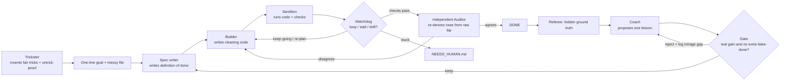

# Unfoolable 🛡️
**Most AI agents can be fooled into saying "done." Unfoolable is a self-improving agent team that trains against an adversary, verified by an independent Auditor, so it can't fool itself.**

Built from scratch at The Recursive Agents Hackathon (Oct 17, 2026) on **Crusoe Managed Inference**, with **NVIDIA Nemotron** for every agent role (gpt-oss-120b only as automatic fallback when the API was busy). Total cost of every experiment: **under $5**.

## Headline results (hidden tasks on data kinds never seen in training)
| | Result |
|---|---|
| False "done" claims, WITHOUT vs WITH independent Auditor | **8/9 (89%) → 1/2 (50%)** |
| Starting team + Auditor, 18 hidden tasks | **0 false "done" claims**, accuracy up (94.0→96.8% standard, 45.8→51.9% hard) |
| Self-evolution (v0 → v6), adversarial hard mode | **45.8% → 62.3% accuracy (+16.5 pts)** |
| Coach's predicted gain vs. real gain | **overestimated 7 of 7 times, avg +48 pts** |
| Self-edits proposed by the Coach | 7 proposed → **4 rejected by the gate**, 3 kept |
| Trickster tricks that failed the fairness check | 2 caught by review; now enforced automatically (trick must ship an exact `untrick`) |

Full tables: `AUDIT_RESULTS.md`, `RESULTS.md`, `RESULTS_backup1.md`. Raw data: `runs/`, `runs_backup1/`.

## Architecture


## The problem
Agents fill vague goals with their own assumptions and confidently report success. When agents improve themselves, they also claim every change helped. Our starting team said "done" on hidden tasks and was wrong almost every time.

## How it works
**Cleaner team** (messy data file + one-line goal → clean data):
- **Spec writer** (Nemotron Super): writes its own *definition of done* as executable checks
- **Builder** (Nemotron Super): writes the cleaning code
- **Sandbox**: code runs in a separate process; checks run in another process that never imports the builder's code (nonce-protected)
- **Watchdog** (plain code, no AI): detects loops, stalls, drift → CONTINUE / REPLAN / STOP / ESCALATE
- **Auditor** (Nemotron Super): when the checks pass, it independently re-derives a sample of rows (weirdest first) straight from the raw file, never seeing the code. Any disagreement → not done, fix it. *Independent recomputation, not opinion*, so it works in production where no answer key exists.
- **Checkpoint**: keeps the best attempt, not the last one
- **Needs-human inbox**: every escalation is written to `runs/NEEDS_HUMAN.md`, so you can walk away

**Trickster** (Nemotron Super): invents realistic new ways to corrupt data (fullwidth Unicode, zero-width characters, quoted ids...), aimed at the Cleaner's weak spots. Each trick must ship an `untrick()` that restores the exact original values, run in a separate sandbox. That proves the trick is fair.

**Coach** (Nemotron Super): reads the Cleaner's hidden mistakes and proposes ONE general lesson, with a predicted gain.

**Gate**: old vs. new on the same fresh jobs. Keep a lesson only if accuracy rises ≥2 points AND false "done" claims don't increase. We log the **mirage gap** = predicted − real gain.

**Referee**: ground truth is known exactly (we corrupt clean data we generated), so scoring never needs an LLM judge.

## What we learned
1. **Agents can't grade their own homework.** Without the Auditor, 8 of 9 "done" claims were wrong. An independent Auditor that re-derives the answer from the source cut that sharply.
2. **Self-assessment is a mirage.** The Coach predicted +28% to +65% for every lesson; real effects ranged from −28 to +12 points. Only the gate kept the team from getting worse.
3. **Adversaries cheat too.** The Trickster invented tricks that destroyed information. Fix: it must prove fairness with an exact inverse.
4. **Trust has a price.** With the Auditor, the team says "done" less often. For agents you walk away from, "not sure" beats confidently wrong.

## Honest limitations
- Small samples (9 hidden tasks per condition, 1 seed); a few points of difference is noise. v6 + Auditor scored lower in hard mode (several runs crashed to 0%).
- The Auditor is itself an LLM and can be wrong; it samples ~8 rows, so rare errors can slip through.
- Run 1 used a harness with two bugs (JSON parsing of regex checks; discarding the best attempt). We fixed them, re-measured the baseline, and report the fixed numbers. Both runs are in the repo.
- Some calls fell back to gpt-oss-120b when Nemotron was busy during peak hackathon load.

## Run it
```
python -m venv .venv && .venv\Scripts\activate
pip install openai rich pandas python-dotenv
# .env -> CRUSOE_API_KEY=...
python team.py --audit          # one live job with the Auditor
python demo.py                  # 3 hidden jobs in parallel with the Auditor (logged for replay)
python evaluate.py              # v0 baseline on hidden tasks
python evolve.py 3 [--resume]   # Trickster vs Cleaner, Coach + Gate
python final.py                 # before/after table -> RESULTS.md
python final2.py                # Auditor experiment -> AUDIT_RESULTS.md
python replay.py runs/live_log.jsonl 40 TRICK,COACH,KEEP,REJECT,SCORE
```

## Models (Crusoe Managed Inference)
`nvidia/NVIDIA-Nemotron-3-Super-120B-A12B` for every agent role; `openai/gpt-oss-120b` only as automatic fallback when Nemotron is busy.

## Files
`data.py` clean data generator · `tricks.py` base tricks + scorer · `team.py` Cleaner team, sandbox, watchdog, Auditor · `trickster.py` tricks + fairness proof · `evolve.py` self-improvement loop · `evaluate.py` · `final.py` · `final2.py` · `demo.py` live demo with Auditor · `replay.py` replay recorded runs